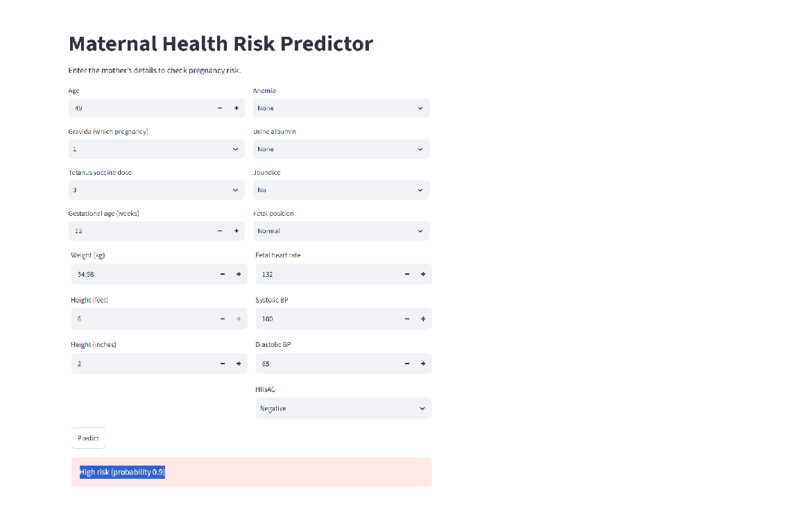

# Maternal Health Risk Predictor

A web app that predicts whether a pregnancy is **high risk** from a mother's health details. Built with a Random Forest model, a Flask backend and a Streamlit frontend.

## Dataset
Maternal health data from Mendeley Data (https://data.mendeley.com/datasets/8k9pvpmykk/1). 998 records, 19 columns. The raw CSV is not included in this repo because it contains patient names.

## What I did
- Cleaned the data: converted height (feet/inches) to cm, turned "1st/2nd/3rd" into numbers, encoded severity levels (None/Minimal/Medium/Higher) as 0 to 3, and dropped the patient name.
- Explored each column against the target. Tetanus vaccine dose and HRsAG showed the clearest relationship with risk.
- Trained a Random Forest on an 80/20 stratified split.

## Results
| Model | Accuracy | Recall (high risk) |
|-------|----------|--------------------|
| 14 features | 92% | 0.95 |
| 4 selected features | 90% | 0.92 |

Top features by importance: Weight, Diastolic BP, Tetanus vaccine dose, Systolic BP.

## Limitations
- The model was trained on mostly young mothers (average age about 23), so predictions for older ages are less reliable.
- Some columns (like VDRL) looked unrelated to the target, so the labels may not come from real clinical rules.
- This is a learning project, not a medical tool.

## How to run
```
pip install -r requirements.txt
python app.py
```
Then, in a second terminal:
```
streamlit run streamlit_app.py
```

## Screenshot



## Tech
Python, pandas, scikit-learn, Flask, Streamlit


**Live demo:** https://maternal-health-risk-app-nnlznpnigt9uhpfnbvffs6.streamlit.app/